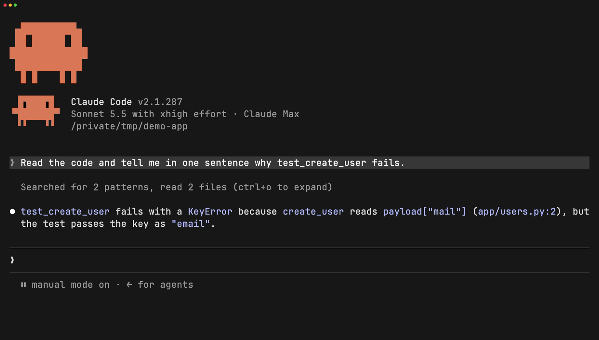

<h1 align="center">cc-prompt-enhance-mod</h1>

<p align="center">
  <b>One click turns a vague draft into a precise prompt, without making it longer than it needs to be.</b><br>
  A <a href="https://code.claude.com/docs/en/plugins/mods/overview">Claude Code mod</a> that adds an <b>Enhance</b> button above the prompt.
</p>

<p align="center">
  
  
  
</p>

<p align="center">
  
</p>

<p align="center"><sub>A real Claude Code session, recorded with <a href="https://github.com/charmbracelet/vhs">VHS</a> from <a href="scripts/demo.tape"><code>scripts/demo.tape</code></a>.</sub></p>

---

You type `fix that error so the test pases`. Claude already knows which error you mean, but your prompt doesn't say. **Enhance** asks Sonnet to fill that in:

```diff
- fix that error so the test pases
+ fix the `KeyError: 'mail'` in `app/users.py:2` so `tests.test_users.TestUsers.test_create_user` passes
```

- **Grounded edits.** It fixes typos, resolves "this", "that file" or "the error" from the recent conversation, names what "done" looks like, carries over constraints you already settled, and splits multi-part asks into steps. Everything it adds comes from your draft or the conversation; choices you left open stay open.
- **Leaves clear drafts alone.** If there's nothing to resolve, your draft comes back unchanged, in the language you wrote it in.
- **One key, both ways.** Ctrl+E enhances. Press it again to revert.

## Install

Run these as two separate prompts in Claude Code:

```text
/plugin marketplace add yibudak/cc-prompt-enhance-mod
```
```text
/plugin install cc-prompt-enhance-mod@cc-prompt-enhance-mod
```

Then run `/reload-plugins`, or start a new session. The button appears once you type. Drafts under two words or ten characters turn red with "This prompt is too short to enhance".

### Ctrl+E (one-time setup)

A plugin can't add key bindings, so add this to `~/.claude/keybindings.json`. Run `/keybindings` to open the file, and merge the entry if you already have bindings:

```json
{
  "bindings": [
    { "context": "Global", "bindings": { "ctrl+e": "app:cycleDiffBase" } }
  ]
}
```

<details>
<summary>Why this action, and why <code>Global</code></summary>

- A mod's button can only be pressed through an existing Claude Code action. `app:cycleDiffBase` is used only by the `/diff` panel, so it's free at the prompt. While `/diff` is open, Ctrl+E goes to the panel.
- In the `Chat` context, the prompt's own Ctrl+E (move to end of line) wins. `Global` doesn't have that problem.
- While the button shows, Ctrl+E doesn't move to the end of the line. Use End instead.

</details>

Without the binding, press Ctrl+X Tab, then E. In fullscreen rendering (`/tui`), you can also click the button.

## How it works

| | |
| :- | :- |
| **Model** | `sonnet`, through your own Claude Code session and account. The alias resolves on Anthropic, Bedrock and Vertex. |
| **What's sent** | The system prompt in [`hooks/register.tsx`](hooks/register.tsx), your draft, and the session's last 10 messages. Each message is capped at 2,000 characters and the whole context at 12,000. Tool calls are listed by name and file path or command. |
| **Your draft** | Replaced with the edit. If you kept typing while Sonnet answered, your version stays. |
| **Revert** | Brings back the original. Editing the text or sending it clears Revert. |

## Requirements

- Claude Code v2.1.287 or later, in a terminal
- Not tested in the Desktop app's Code tab. The app draws its own prompt box, and the mods API says a mod can't read or fill a box like that, so expect it not to work there.

## Permissions

A mod runs with your permissions, so check what it reaches before you install it:

```bash
claude plugin validate .claude-plugin/plugin.json
```

It reads the conversation and the prompt box, fills the prompt box, makes one model call per press and shows toasts. It doesn't read files, start processes or make other network requests.

## Development

```bash
git clone https://github.com/yibudak/cc-prompt-enhance-mod
claude --plugin-dir ./cc-prompt-enhance-mod            # loads it and hot-reloads on save
claude plugin validate ./cc-prompt-enhance-mod/.claude-plugin/plugin.json
claude plugin test ./cc-prompt-enhance-mod
cd cc-prompt-enhance-mod && vhs scripts/demo.tape      # re-records assets/demo.gif
```

Claude Code writes the API types to `.claude-plugin/types/` when it loads the mod. That folder is ignored by git.

## License

[MIT](LICENSE) © Yigit Budak
